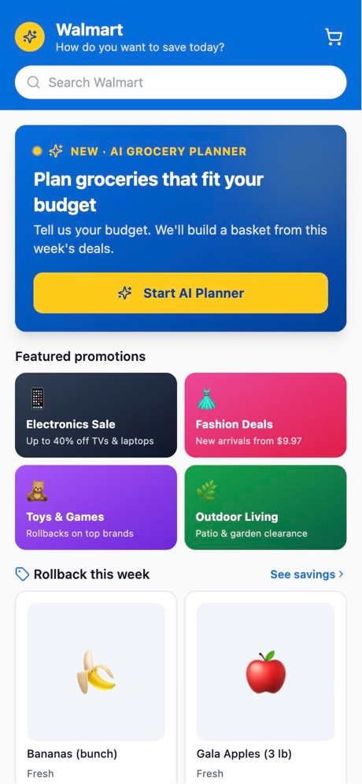
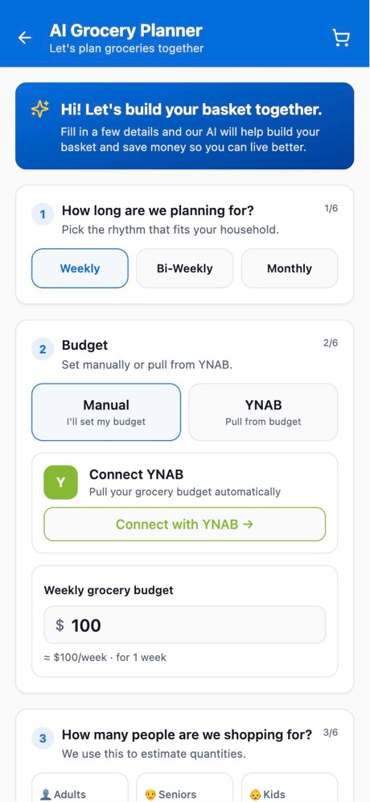
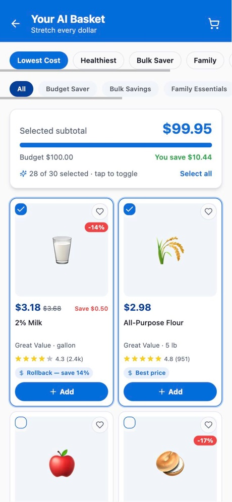
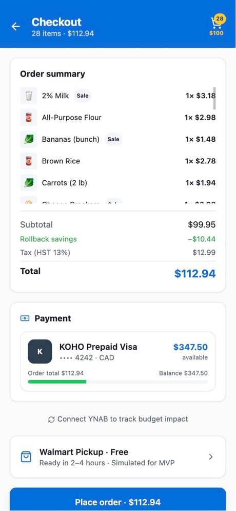
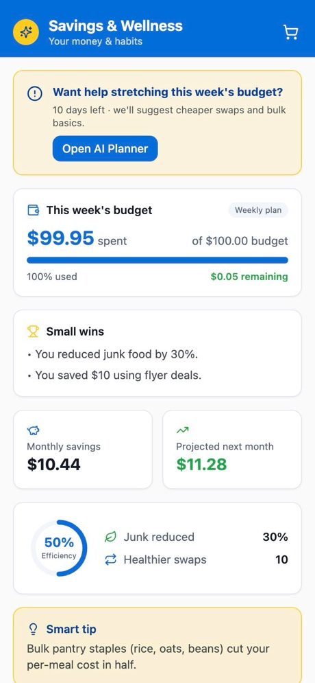
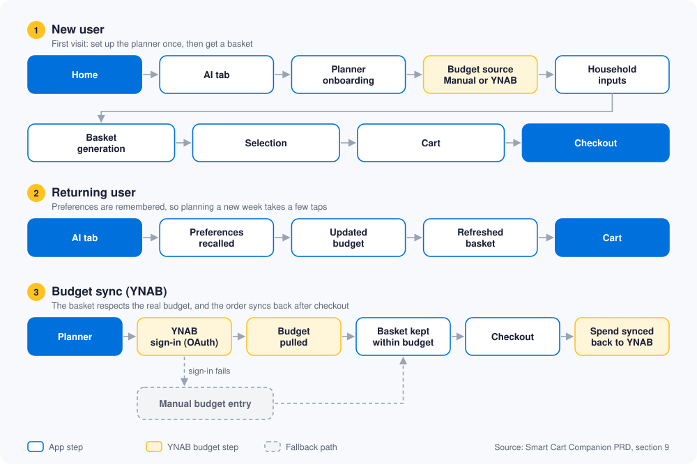

<h1 align="center">Smart Cart Companion</h1>

An AI grocery planner for Walmart+ that helps households plan the week's groceries within a real budget. It turns this week's flyer deals into a personalized basket, checks it against your YNAB budget, and hands it off to the Walmart cart.

Built as a product prototype during an AI Product Management course.

**Live demo:** https://budget-cart-companion.vercel.app · **Full PRD:** [smart-cart-companion-prd.pdf](about-the-product/smart-cart-companion-prd.pdf)

<table>
  <tr>
    <td align="center"><br><sub>Home</sub></td>
    <td align="center"><br><sub>AI Planner</sub></td>
    <td align="center"><br><sub>AI basket</sub></td>
    <td align="center"><br><sub>Checkout</sub></td>
    <td align="center"><br><sub>Savings &amp; Wellness</sub></td>
  </tr>
</table>

<sub>Screens from the live demo running on mock data.</sub>

## 🌟 Product vision

**Plan groceries smarter within budget.**

The long-term goal is a household-first AI planning ecosystem that:

- automates flyer savings
- aligns with real budgets
- encourages healthier decisions
- builds repeat weekly grocery habits
- strengthens Walmart+ retention

The bigger bet: move Walmart from a place where groceries are *bought* to the place where households *plan* them.

## 🧩 The problem

**For shoppers:** grocery planning is spread across separate tools: weekly flyers, a budgeting app, and the effort of hunting for savings. The result is overspending, missed flyer savings and decision fatigue.

**For Walmart:** Walmart is excellent at fulfilling orders, but it lacks:

- proactive flyer intelligence
- budget-aware planning
- household optimization
- a link to the household's financial tools

**The opportunity:** make Walmart+ the default place where households plan their groceries.

## 👥 Who it's for

**Users:**

- budget-conscious households
- students
- meal preppers
- Walmart+ subscribers

**Customer (who benefits and pays):** Walmart, through better Walmart+ retention, more repeat grocery orders and larger recurring baskets. Secondary revenue could come from fintech referral partnerships and premium AI planning tools.

## 💡 The solution

Plan → Basket → Check → Buy → Review:

1. **Plan:** a single-page onboarding asks for the planning period, the budget (typed in, or pulled from YNAB), household size, dietary preferences and pantry items.
2. **Basket:** AI builds a basket from this week's flyer and rollback deals (OpenAI, or a built-in local engine). Shoppers can switch between strategies: lowest cost, healthiest, bulk saver, family, brand.
3. **Check:** the basket is validated against the budget. Checkout shows the KOHO balance and the YNAB budget impact before the order is placed.
4. **Buy:** the basket is handed off to the Walmart cart, and the spend syncs back to YNAB.
5. **Review:** the Savings & Wellness dashboard shows budget used, savings and small wins.

### 🔀 User flows



If YNAB or the flyer feed is unavailable, the app keeps working: a manual budget replaces YNAB, and a default optimized catalog replaces live flyer data.

## 🎯 Goals and success metrics

**North Star: Weekly Repeat Grocery Planning Usage.** The share of users who come back every week to plan with the AI Planner. Groceries are a weekly habit, so repeat planning is the clearest sign the product has become part of the routine.

| Type | Metric | What it measures | Target |
|---|---|---|---|
| North Star | Weekly repeat planning usage | % of users returning weekly to the AI Planner | +25% in the first 6 months of the Walmart+ beta |
| Business | Basket conversion rate | % of AI baskets added to cart and moved toward checkout | +10–15% |
| Business | Walmart+ retention uplift | Increase in Walmart+ retention among planner users | +8–12% |
| Business | Flyer savings utilization | How much of the available flyer savings shoppers use | +25% |
| User trust | Budget compliance rate | % of baskets that stay within the stated budget | > 70% |
| Operational | Basket generation speed | Time to generate a basket | < 3 seconds |

**Operational targets:** API uptime > 99%, cart accuracy > 99%, flyer data refreshed within 24 hours.

These are planning targets for the beta, not measured results. They are based on competitor analysis, observed grocery-planning behavior and gap analysis, and still need validation with real users during the beta. The reasoning behind each target is in the [PRD](about-the-product/smart-cart-companion-prd.pdf).

## 🥊 Competitive landscape

| Product | Strong at | Gap Smart Cart Companion fills |
|---|---|---|
| Walmart (native app) | Commerce and product range | No budget intelligence, flyer automation or household planning |
| Flipp | Finding flyer deals | Doesn't build a personal basket or complete the purchase |
| Instacart | Convenient delivery | Little budget-first planning, weak financial integration |
| Amazon Fresh | Commerce and logistics | No flyer optimization or household budget alignment |
| YNAB | Budgeting | Doesn't turn the budget into an actual grocery plan |

**Differentiator:** the only option that combines grocery planning, flyer automation, budget sync, household personalization and repeat-purchase intelligence.

## 📦 MVP scope

**In the MVP:** AI Grocery Planner, personalized onboarding, household-size and dietary optimization, flyer/rollback ingestion (mock data, built to scale), YNAB budget sync, basket generation, budget validation, Walmart cart handoff.

**Optional power features:** KOHO balance awareness, Smart Repeat, Tiny Wins, pantry intelligence, advanced wellness, full predictive grocery automation.

| Integration | Status |
|---|---|
| Supabase database | Real |
| YNAB OAuth and sync-back | Real |
| Basket generation (local engine or OpenAI) | Real |
| Vercel deployment | Real |
| Walmart live product and flyer APIs | Conceptual (mock catalog for now) |
| KOHO / Plaid full integration | Conceptual (demo mode in the app) |
| Live payments and order processing | Conceptual (simulated checkout) |

**Prioritization (RICE):**

- **Highest:** AI Planner, Budget Sync, Flyer Automation
- **Medium:** Smart Repeat, wellness optimization
- **Lower:** behavioral insights, pantry intelligence

## 🧪 Experiments

| Test | Compares | Measures |
|---|---|---|
| A | AI Planner vs. the standard Walmart grocery flow | Basket conversion, savings utilization, repeat usage |
| B | YNAB-synced budgets vs. manual budgets | Budget compliance, retention, user trust |

## ⚠️ Risks and how they're handled

| Assumption | If it fails | Mitigation |
|---|---|---|
| Users trust AI recommendations | Low basket adoption | Hybrid controls and manual overrides, more transparency |
| Flyer data stays accurate | Wrong savings shown | Freshness monitoring, fallback to a default catalog |
| Budget sync is reliable | OAuth / API failures | Manual budget fallback |
| Walmart APIs are accessible | Limited real-time integration | Mock data with a scalable architecture, phased rollout |
| AI recommendations are good | Poor personalization | Feedback loops and confidence scoring |

## 🗺️ Rollout and milestones

| Milestone | Goal | Status |
|---|---|---|
| MVP prototype | Core AI planner and Walmart workflow | Completed |
| PRD and strategy | PRD for stakeholders | Current |
| Beta integration | Walmart+ pilot deployment | Planned |
| Smart Repeat launch | Behavioral retention layer | Phase 2 |
| Household grocery operating system | Full ecosystem expansion | Phase 3 |

**Rollout:** Phase 1 is a Walmart+ beta for budget-conscious households and families. Phase 2 expands regionally and adds Smart Repeat. Phase 3 grows into a full household grocery ecosystem.

## 🧭 Product principles

Budget clarity · Household simplicity · Savings automation · User trust · Configurable control · Walmart-native experience · Sustainable repeat behavior

## 📍 Where it stands

A working prototype with mock catalog data. YNAB and OpenAI connect when API keys are added; KOHO, Walmart APIs and payments run in demo mode. Every integration falls back to demo mode without keys, so the live demo works without any accounts.

## 📁 Repo map

| Folder | What's inside |
|---|---|
| [`about-the-product/`](about-the-product/) | The PRD, product vision and the early MVP plan |
| [`designs-and-screens/`](designs-and-screens/) | App screenshots and user flow diagrams |
| [`frontend/`](frontend/) | An older copy of the app made with the Emergent builder. Kept until its unique features are reviewed |
| [`setup-guide/`](setup-guide/) | How to run the app and connect OpenAI, Supabase, YNAB and Plaid |
| [`the-app/`](the-app/) | The app itself: all code and its settings |

## 🛠️ Built with

React 18, TypeScript, Vite, Tailwind CSS, shadcn/ui, React Router · OpenAI (GPT-4o-mini) · Supabase · YNAB API · Plaid · Vercel

## 🚀 Run it locally

```bash
cd the-app
npm install
npm run dev
```

Then open http://localhost:8080. To turn on real integrations, see [`setup-guide/setup-and-integrations.md`](setup-guide/setup-and-integrations.md).

## 👤 Author

Varun Sagar K
